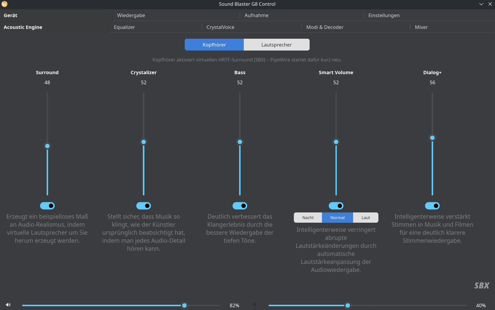

# Sound Blaster G8 Control

Natives Linux-Kontrollpanel für den Creative Sound Blaster G8 (USB-DAC/Kopfhörerverstärker), geschrieben in Rust mit [Slint](https://slint.dev/). Bildet die Original-Windows-Software nach – Acoustic Engine, 10-Band-Equalizer, CrystalVoice, Scout Mode, Decoder, Mixer und mehr –, reverse-engineert aus USB-Captures, da Creative keine offizielle Linux-Unterstützung anbietet.



Inoffizielles Projekt, keine Verbindung zu oder Unterstützung von Creative Technology Ltd.

## Funktionen

- **Acoustic Engine** – Surround, Crystalizer, Bass, Smart Volume (inkl. Nacht/Normal/Laut), Dialog+
- **10-Band-Equalizer** mit Vorverstärkung und Sound-Modus-Presets
- **CrystalVoice** – Noise Reduction, Echo Cancellation, Voice Morph, Mikrofon-Equalizer
- **Modi & Decoder** – Direct Mode, Scout Mode (inkl. Zugriffstaste), Dolby-Decoder
- **Mixer** – alle Ein-/Ausgangspegel inkl. Stummschaltung
- **Wiedergabe** – 7.1-Positionsdiagramm mit Testtönen, Kopfhörer/Lautsprecher-Umschaltung
- **Virtueller HRTF-Kopfhörer-Surround**: PipeWire-Filter-Chain mit HeSuVi-Faltung, da die G8-Hardware selbst nur Stereo ausgibt
- **Lautstärkeknopf-Livesync**: der physische Regler am Gerät steuert live den Regler in der App (und optional die PipeWire-Systemlautstärke, "Volume Sync")
- Dark Mode

## Status

Funktionsfähig und in aktiver Entwicklung. Große Teile des proprietären USB-Protokolls sind aus echten Captures rekonstruiert (siehe [HANDOFF.md](HANDOFF.md)) – manche Funktionen (Gerät-Presets speichern, Firmware-Anzeige, Energiesparen, Logo-LED) sind noch nicht reverse-engineert und im UI vorbereitet, aber ohne Wirkung. Der physische Kopfhörer/Lautsprecher-Schalter am Gerät lässt sich auslesen, aber nicht per Software fernsteuern (reine Hardware-Funktion).

## Voraussetzungen

- Linux mit PipeWire (für den virtuellen Surround) und ALSA
- Rust-Toolchain (`cargo`)
- Ein angeschlossener Sound Blaster G8 (USB-ID `041e:329b`)

## Bauen & Starten

```bash
cargo run --release
```

Ohne angeschlossenes Gerät startet die App trotzdem – alle proprietären Befehle werden dann nur geloggt statt gesendet.

## Installieren (Desktop-Integration)

```bash
./packaging/install.sh
```

Baut die Release-Version und installiert Binary, Icon und `.desktop`-Eintrag nach `~/.local/{bin,share}` (kein root nötig). Zum Deinstallieren einfach die dort angelegten Dateien wieder löschen.

## Technische Details

Das proprietäre USB-Protokoll (HID Vendor-Kanal auf Interface 4) sowie die genutzten Standard-USB-Audio-Class-Mechanismen sind in [HANDOFF.md](HANDOFF.md) dokumentiert.
